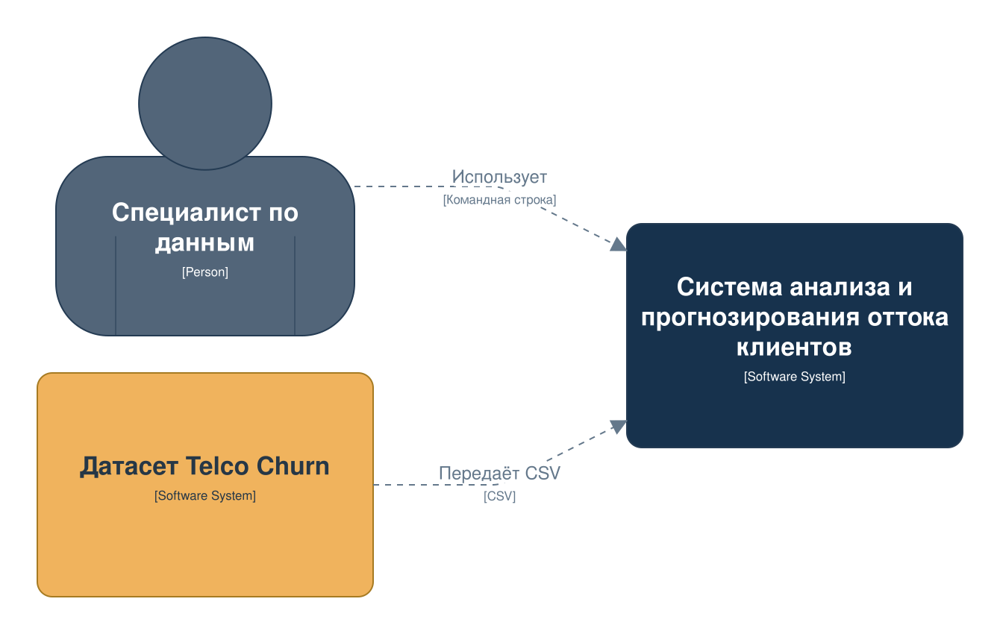
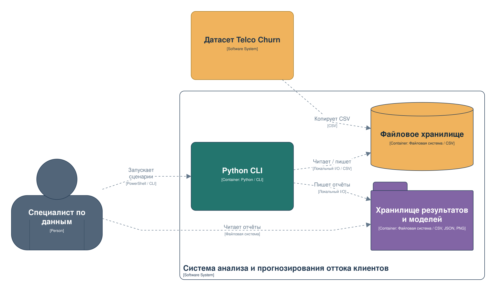
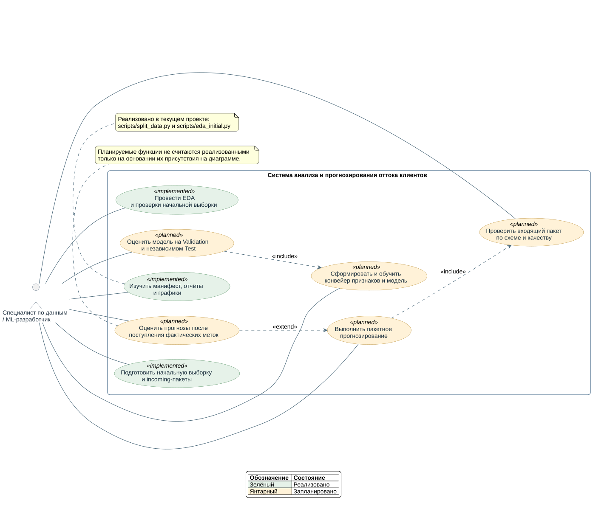
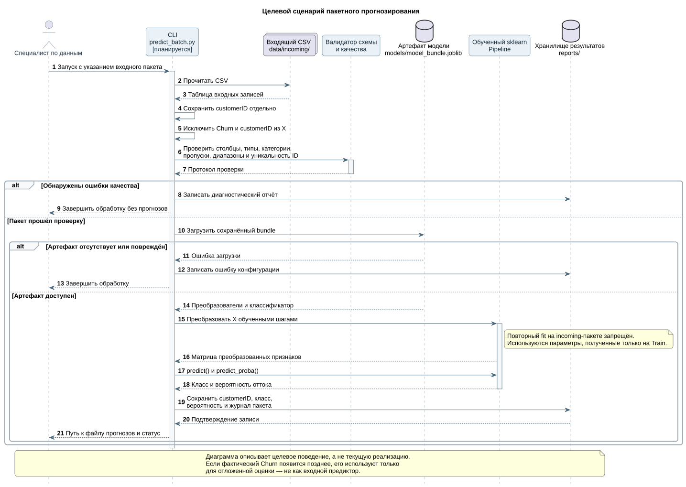

# 2.5. Архитектура системы анализа и прогнозирования оттока клиентов

## Назначение и границы системы

Разрабатываемая система представляет собой локальный исследовательский ML-проект для анализа данных о клиентах телекоммуникационной компании и последующего прогнозирования вероятности оттока. На текущем этапе предусмотрен пакетный режим работы: специалист запускает Python-скрипты из командной строки, а данные и результаты сохраняются в файловой структуре проекта.

Постоянно работающий сервер, веб-интерфейс, API и прямое подключение к производственной CRM в текущий объём проекта не входят. Внешним источником служит предоставленный CSV-набор Telco Customer Churn. В нём отсутствуют достоверные временные метки снимков клиентов, поэтому файлы `data/incoming/batch_01.csv`–`batch_04.csv` используются для воспроизводимой имитации поступления порций, а не подтверждают реальную хронологическую последовательность событий.

Важно различать два уровня разбиения данных:

- уже реализованное разбиение исходного CSV на начальную выборку `data/initial/initial_60.csv` и четыре входящих пакета `data/incoming/`;
- предусмотренное проектом разбиение исторической выборки на Train, Validation и Test для разработки и независимой оценки модели. Второе разбиение в текущей реализации ещё не выполнено.

## Текущее состояние реализации

На момент проверки фактической структуры проекта реализованы следующие элементы:

- исходный CSV хранится отдельно в `data/raw/`;
- `scripts/split_data.py` формирует начальную выборку и четыре входящих пакета, рассчитывает SHA-256 и обновляет `reports/data_manifest.csv`;
- `scripts/eda_initial.py` выполняет разведочный анализ `initial_60.csv` и формирует отчёты и графики в `reports/eda/`;
- проект ведётся под контролем версий Git; отдельные отчёты и конфигурационные файлы хранятся в репозитории.

Следующие компоненты пока являются проектируемыми, а не реализованными:

- автоматическая валидация входящего пакета по схеме, типам, категориям, пропускам и дубликатам;
- единый обучаемый конвейер предобработки и формирования признаков;
- обучение и сравнение моделей, расчёт метрик на Validation и независимом Test;
- сохранение обученной модели и преобразователей в `models/`;
- пакетное прогнозирование новых порций и сохранение результатов прогнозов.

Каталог `models/` предусмотрен в структуре проекта, однако наличие каталога само по себе не означает, что обученная модель уже создана. Аналогично, наличие файлов в `data/incoming/` не означает, что готов валидатор или механизм потоковой обработки.

## Контекст C4 (Context)

Диаграмма контекста показывает систему как единое целое, основного пользователя, внешний источник данных и результаты работы. Специалист по данным запускает локальные сценарии, передаёт подготовленные CSV-файлы и изучает сформированные отчёты. На текущем этапе подтверждёнными результатами являются манифест данных и отчёты EDA. Сохранённая модель и файл пакетных прогнозов относятся к целевому состоянию и появятся после реализации этапа моделирования.

Единый редактируемый исходник представлений C4 Context и C4 Container: [`workspace.dsl`](../../diagrams/workspace.dsl), представление `context`.

## Контейнерная диаграмма C4 (Container)

В рамках локального проекта выделены следующие логические контейнеры. Они не являются отдельными сетевыми службами: все процессы выполняются в одном локальном окружении и взаимодействуют преимущественно через файлы.

| Контейнер | Назначение и состояние | Основные технологии / расположение |
|---|---|---|
| CLI-скрипты проекта | Подготовка начальной выборки и пакетов, EDA — реализованы. Валидация входных пакетов, единый ML-конвейер, обучение и прогнозирование — запланированы. | Python; `scripts/split_data.py`, `scripts/eda_initial.py`; будущие модули — после реализации |
| Хранилище данных | Хранение неизменяемого исходного CSV, начальной выборки и входящих пакетов. | Локальная файловая система; `data/raw/`, `data/initial/`, `data/incoming/` |
| Хранилище результатов и моделей | Отчёты, манифест и графики уже формируются. Каталог для модели предусмотрен, но сохранённая обученная модель пока отсутствует. | `reports/data_manifest.csv`, `reports/eda/`, `reports/`; каталог `models/` |

Git/GitHub не являются внутренним контейнером выполняемой ML-системы. Как вспомогательные средства разработки и версионного контроля они показаны за границей системы на диаграмме контекста C4. В контейнерное представление C4 они не включаются, поскольку не участвуют в выполнении сценариев обработки данных и не являются runtime-зависимостью. Контроль версий также не заменяет проверки качества данных.

Единый редактируемый исходник представлений C4 Context и C4 Container: [`workspace.dsl`](../../diagrams/workspace.dsl), представление `containers`.

Git используется для фиксации истории изменений и не заменяет контроль качества данных. Эталонный CSV рассматривается как неизменяемый источник: подготовка выполняется над производными файлами, а не путём перезаписи исходника.

## Диаграмма вариантов использования UML (Use Case)

Основной актор — специалист по данным / ML-разработчик. Целевые варианты использования включают подготовку пакетов, проверку входных данных, EDA, формирование признаков, обучение и оценку модели, пакетное прогнозирование и изучение отчётов. Подготовка выборок и EDA реализованы. Проверка новых пакетов, моделирование и прогнозирование остаются целевыми функциями и не должны трактоваться как завершённые только на основании наличия диаграммы.

Редактируемый исходник: [`use_case.puml`](../../diagrams/source/use_case.puml).

## Диаграмма последовательности UML (Sequence)

Диаграмма описывает целевой сценарий обработки нового пакета после реализации этапа моделирования. Пользователь запускает сценарий прогнозирования; программа загружает пакет и сохранённые артефакты, проверяет схему и допустимые значения. При ошибке проверки обработка прекращается с диагностическим сообщением. При корректном входе сохранённый конвейер применяет обученные преобразования, модель рассчитывает класс и вероятность оттока, после чего результаты сохраняются в файл.

Сценарий пакетного прогнозирования пока не реализован: в текущем дереве проекта отсутствует готовый `predict_batch.py`, обученная модель и сохранённый преобразователь. Поэтому диаграмма является проектной спецификацией будущего поведения.

Для прогноза нельзя использовать `Churn` и `customerID` как предикторы. `Churn` является целевой переменной при обучении и может использоваться для последующей оценки только после появления фактической метки. `customerID` сохраняется отдельно для сопоставления результата с исходной записью. Временная доступность `TotalCharges` на дату прогноза также должна быть подтверждена до включения этого поля в основной набор признаков.

Редактируемый исходник: [`sequence_batch_prediction.puml`](../../diagrams/source/sequence_batch_prediction.puml).

## Архитектурные решения и ограничения

1. **Пакетная обработка.** Сценарии запускаются явно из командной строки; это соответствует масштабу учебного проекта и упрощает воспроизводимость.
2. **Разделение исходных, входящих и производных данных.** Исходный CSV хранится отдельно; начальная выборка и входящие пакеты создаются как производные копии. Исходный файл не перезаписывается.
3. **Различение учебного разбиения и ML-разбиения.** Реализованное разделение `initial_60` / `incoming` имитирует поступление порций. Train / Validation / Test — отдельный будущий этап разработки модели.
4. **Единый воспроизводимый конвейер преобразований.** После реализации одни и те же обученные преобразования должны применяться при Validation, Test и прогнозировании; повторная подгонка преобразователей на новых пакетах не допускается.
5. **Контроль входов.** Перед прогнозированием должны проверяться наличие обязательных столбцов, типы, категории, пропуски, диапазоны и уникальность идентификаторов. Некорректная порция не должна незаметно попадать в прогнозирование.
6. **Фиксация артефактов.** Для каждого запуска должны сохраняться входной файл или ссылка на манифест, SHA-256, seed, схема признаков, параметры и метрики. Модель и прогнозы будут добавлены после реализации соответствующих этапов.
7. **Ограничение выводов.** Ассоциации, обнаруженные на статическом наборе, не доказывают причинность и не гарантируют качество на будущих данных. Временная доступность отдельных полей должна быть подтверждена отдельно.

## Исходники диаграмм

C4 Context и C4 Container поддерживаются в одном текстовом исходнике Structurizr DSL — `diagrams/workspace.dsl`. Диаграммы UML Use Case, Sequence и Activity поддерживаются в PlantUML (`.puml`). Диаграммы ML pipeline и логической архитектуры системы поддерживаются в D2 (`.d2`). Экспортированные SVG и PNG размещаются отдельно от исходников в `diagrams/svg/` и `diagrams/png/`.

**Вывод по подразделу 2.5.** Для проекта выбрана локальная пакетная архитектура с запуском Python-скриптов из командной строки, раздельным хранением исходных и производных данных, сохранением отчётов и использованием Git. На текущем этапе реализованы подготовка выборок и EDA; валидация входящих порций, единый конвейер признаков, обучение модели и пакетное прогнозирование остаются целевыми компонентами. Такое разграничение не позволяет ошибочно представить проектируемые функции как уже испытанные и задаёт проверяемую основу для последующей реализации.
