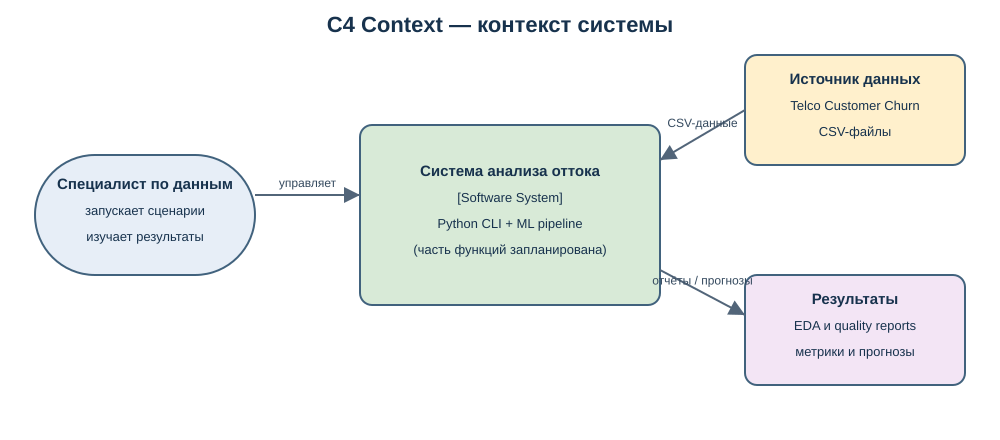
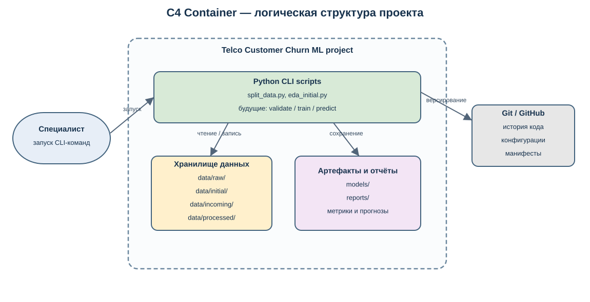
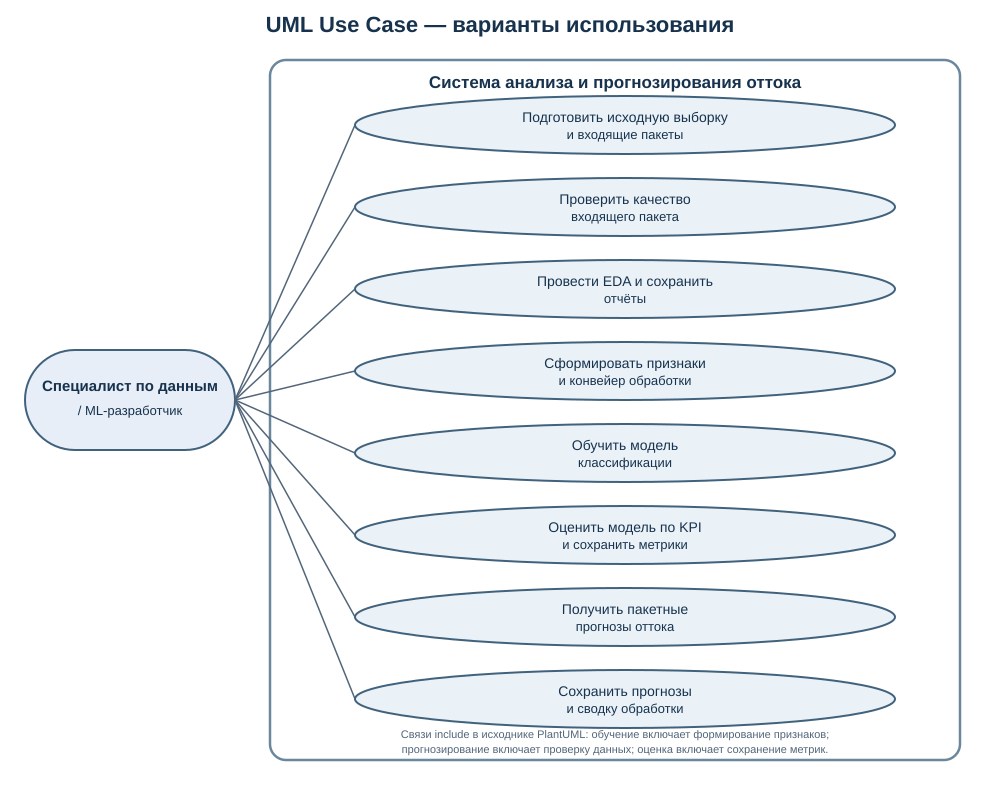
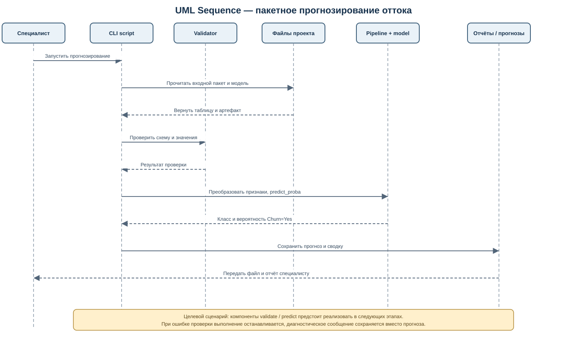

# 2.5. Архитектура системы анализа и прогнозирования оттока клиентов

## Назначение и границы системы

Разрабатываемая система представляет собой локальный исследовательский ML-проект для анализа данных о клиентах телекоммуникационной компании и прогнозирования вероятности оттока. На данном этапе предполагается пакетный режим работы: специалист запускает Python-скрипты из командной строки, а входные данные, модель, прогнозы и отчёты сохраняются в файловой системе проекта.

Архитектура не предполагает веб-интерфейс, постоянно работающий сервер, API или подключение к производственной CRM. Эти компоненты не входят в текущий объём курсовой работы. В качестве внешнего источника используется предоставленный CSV-файл Telco Customer Churn. Поскольку в наборе нет достоверной даты поступления каждой записи, файлы в `data/incoming/` служат для воспроизводимой имитации последовательного поступления пакетов, а не доказывают наличие реального потока событий.

На текущем этапе реализованы подготовка начальной выборки и пакетов, манифест данных, а также исследовательский анализ начальной выборки. Проверка новых пакетов, построение полного конвейера признаков, обучение модели и пакетное прогнозирование относятся к целевому состоянию архитектуры и должны быть реализованы и проверены в последующих этапах.

## Контекст C4 (Context)

Диаграмма контекста показывает систему как единое целое, основного пользователя, внешний источник данных и формируемые результаты. Специалист по данным запускает анализ и ML-сценарии, предоставляет исходный или входящий CSV-файл и изучает отчёты. Результат работы — отчёты о качестве данных, EDA и метриках, а после реализации этапа обучения — сохранённая модель и файл с прогнозами.

Редактируемый исходник: [`c4_context.puml`](diagrams/c4_context.puml).

## Контейнерная диаграмма C4 (Container)

В рамках локального проекта выделены следующие контейнеры уровня архитектуры:

| Контейнер | Назначение | Основные технологии / расположение |
|---|---|---|
| CLI-скрипты проекта | Запуск сценариев подготовки данных, EDA и будущих этапов ML-конвейера | Python; каталог `scripts/` |
| Хранилище данных | Хранение неизменяемого исходного CSV, начальной выборки, входящих пакетов и при необходимости обработанных данных | Локальная файловая система; `data/raw/`, `data/initial/`, `data/incoming/`, `data/processed/` |
| Хранилище моделей и результатов | Сохранение обученной модели, таблиц анализа, проверок качества, метрик и прогнозов | Локальная файловая система; `models/`, `reports/` |
| Git-репозиторий | История изменений кода, конфигураций, манифестов и выбранных отчётных артефактов | Git и удалённый репозиторий GitHub |

Диаграмма отражает логическую организацию локального решения, а не отдельные сетевые сервисы: Python-скрипты выполняются в одном окружении проекта, а данные и результаты передаются через файлы. Git используется для фиксации изменений проекта; он не заменяет контроль качества данных и не должен изменять байты эталонного исходного CSV.

Редактируемый исходник: [`c4_container.puml`](diagrams/c4_container.puml).

## Диаграмма вариантов использования UML (Use Case)

Основной актор — специалист по данным / ML-разработчик. Он может подготовить воспроизводимые пакеты, проверить входные данные, выполнить EDA, сформировать признаки, обучить и оценить модель, а затем запустить пакетное прогнозирование и изучить отчёты. Обучение и прогнозирование показаны как предусмотренные функции целевого решения; они не считаются реализованными только на основании наличия диаграммы.

Редактируемый исходник: [`use_case.puml`](diagrams/use_case.puml).

## Диаграмма последовательности UML (Sequence)

На диаграмме показан целевой сценарий обработки нового пакета после реализации этапа моделирования. Скрипт загружает пакет и сохранённые артефакты, проверяет схему и допустимые значения. Если проверки не пройдены, выполнение прекращается с диагностическим сообщением. Если данные корректны, обученный конвейер преобразует признаки, модель рассчитывает класс и вероятность оттока, после чего результат сохраняется в файл и формируется краткий отчёт.

Для прогнозирования нельзя использовать столбцы `Churn` и `customerID` как предикторы. `Churn` используется как целевая переменная на этапе обучения и оценки; в сценарии оценки новых данных он может применяться только для последующей проверки качества, когда фактическая метка действительно доступна. Время доступности `TotalCharges` также необходимо подтвердить по бизнес-сценарию до включения признака в производственный прогноз.

Редактируемый исходник: [`sequence_batch_prediction.puml`](diagrams/sequence_batch_prediction.puml).

## Архитектурные решения и ограничения

1. **Пакетная обработка.** Работа запускается явно из командной строки; это соответствует учебному проекту и упрощает воспроизводимость.
2. **Разделение исходных, входящих и производных данных.** Исходный CSV хранится отдельно и рассматривается как неизменяемый источник. Результаты анализа не перезаписывают его.
3. **Единый воспроизводимый конвейер преобразований.** В дальнейшем те же обученные преобразования признаков должны применяться при оценке и прогнозировании; нельзя независимо подгонять обработку на новых пакетах.
4. **Контроль входов.** Проверяются наличие ожидаемых столбцов, типы и допустимые значения, пропуски и дубликаты. Некорректный пакет не должен незаметно попадать в прогнозирование.
5. **Фиксация артефактов.** Сохраняются метаданные исходных данных, параметры эксперимента, метрики и результаты; модель сохраняется в каталоге `models/` после реализации обучения.
6. **Ограничение вывода.** Полученные на статическом наборе связи являются исследовательскими ассоциациями и сами по себе не доказывают причинность и не гарантируют результат на будущих данных.

**Вывод по подразделу 2.5.** Выбрана архитектура локального пакетного ML-приложения с Python-скриптами, файловым хранением данных и отчётов и версионным контролем проекта. Такое решение соответствует текущему масштабу курсовой работы и позволяет воспроизводимо пройти путь от подготовки данных к оценке и пакетному прогнозированию. Диаграммы описывают как уже существующие элементы подготовки данных, так и целевые компоненты, которые предстоит реализовать; поэтому готовность всей системы должна подтверждаться тестами и результатами последующих практических работ.
